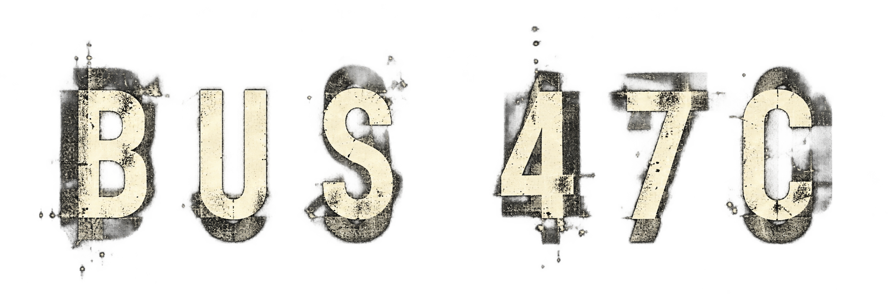
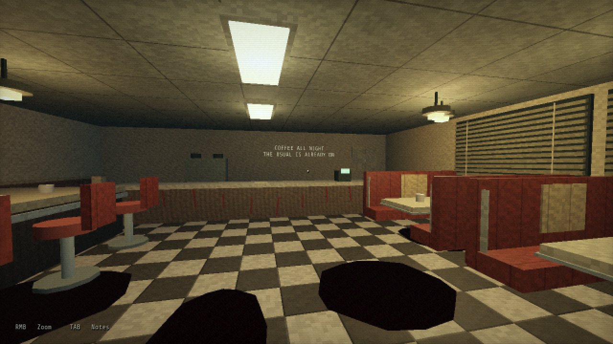

The last bus home. Something is riding with you.

A short, first-person horror game about a firewatcher's journey to Loomesville. Six stops, a forest road and a town that feels wrong.

**[Download the Windows beta](https://github.com/Kenshi0905/bus47c-game/releases/latest)** · [All releases](https://github.com/Kenshi0905/bus47c-game/releases) · [Report a bug](https://github.com/Kenshi0905/bus47c-game/issues/new?template=bug_report.yml)

## Play

1. Download **Bus47C-Beta-0.11.0-Windows.zip** from the release's **Assets** section.
2. Extract the entire ZIP. Keep **Bus47C.exe** and **Bus47C.pck** together.
3. Run **Bus47C.exe** and choose **New Journey**. Headphones recommended.

No Godot installation needed. The playable build targets **Windows x86_64 with OpenGL 3.3**. Other graphical platforms have not been validated.

**0.11.0 Beta 1** includes both story routes, four explorable shops and House 17. This update fixes body dragging and the fallen-body reveal, restores the suited attacker, adds manual wardrobe exits and staged forest encounters, and makes blood read red in the night lighting. More lore and polish are still planned. Contains graphic stylized violence, blood and jumpscares.

The previous [0.10.0 Beta 1 release](https://github.com/Kenshi0905/bus47c-game/releases/tag/v0.10.0-beta.1) remains available for rollback. See the [changelog](CHANGELOG.md) for the full history.

## Controls

| Input | Action |
| --- | --- |
| WASD and mouse | Move and look |
| Hold right mouse | Zoom, or peek while hiding |
| E | Inspect, interact, collect or sit |
| Left mouse or E | Defend when equipped and within reach |
| Space | Stand from a seat |
| Shift | Walk faster |
| Tab | Shift notes and current tasks |
| Escape | Pause, settings and exit |

Settings include volume, sensitivity, field of view, subtitles and the retro filter. Checkpoints are local. Pausing or reading freezes story timers.

## Make it yours

Built in **Godot 4.7.2**, using GDScript and the Compatibility renderer. Character meshes and procedural environments remain editable.

- [Development guide](docs/DEVELOPMENT.md): run, edit, test and export.
- [Gameplay notes](docs/GAMEPLAY.md): mechanics and story branches, with spoilers.
- [Release guide](docs/RELEASING.md): packages, tags and rollback.
- [Art and typography](docs/menu-design.txt) and [audio sources](docs/audio-sources.md).

**Story and direction:** Ashmit Avash. Typography uses Share Tech Mono under the SIL Open Font License. Engine and third-party notices are included in each release.
