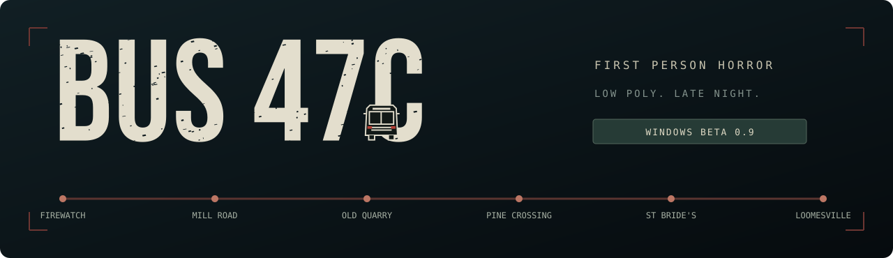
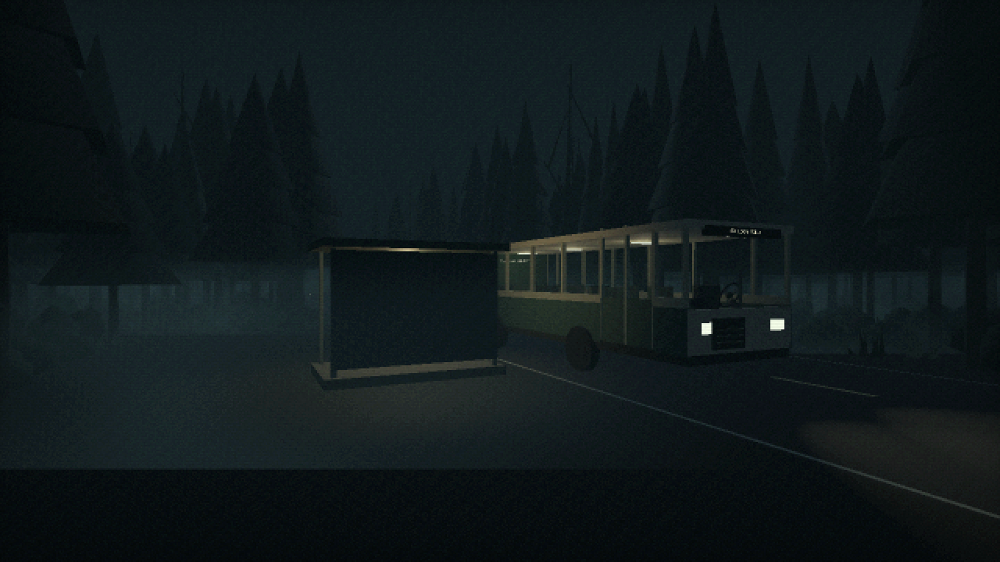
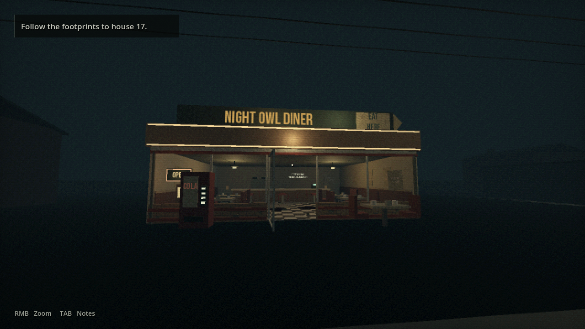
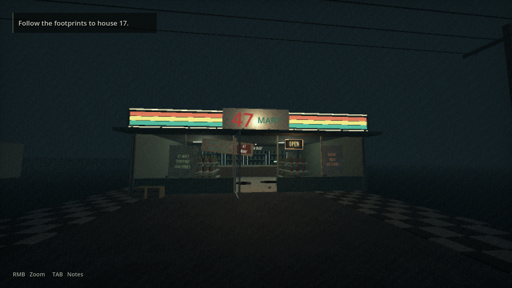
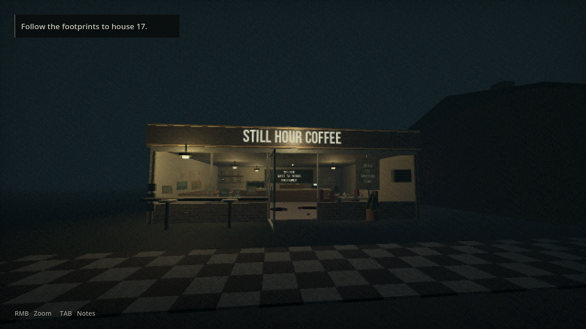
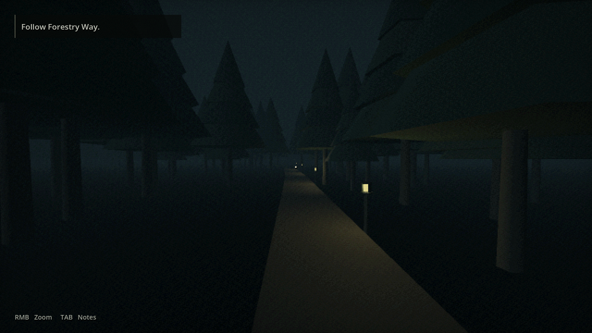

  

<strong>The last bus home. Something is riding with you.</strong>

  <a href="https://github.com/Kenshi0905/bus47c-game/releases/tag/v0.9.0-beta.1"><strong>DOWNLOAD THE WINDOWS BETA</strong></a>
  &nbsp; · &nbsp;
  <a href="https://github.com/Kenshi0905/bus47c-game/releases">All releases</a>
  &nbsp; · &nbsp;
  <a href="CHANGELOG.md">What's changed</a>
  &nbsp; · &nbsp;
  <a href="https://github.com/Kenshi0905/bus47c-game/issues/new/choose">Report a bug</a>

## Your shift is over

You are a firewatcher heading home to Loomesville. Six stops, a quiet road and a handful of strangers should be all that stand between you and your front door.

Then the journey begins to change.

**Bus 47C** is a short, first-person horror game built around uncomfortable silences, passing scenery and the feeling that something has noticed you. Ride through the forest, watch the windows, explore the town and choose how to finish the journey.

> **Playable beta.** Both routes are playable, but more lore and polish are still in development. Contains blood, disturbing imagery and jumpscares.

## Take the last service

| Current build | Platform | Engine | Play style |
| :--- | :--- | :--- | :--- |
| **0.9.0 Beta 1** | Windows x86_64 | Godot 4.7.2 | Single player, first person |

1. Open the [current release](https://github.com/Kenshi0905/bus47c-game/releases/tag/v0.9.0-beta.1) and download **Bus47C-Beta-0.9.0-Windows.zip**.
2. Extract the **whole ZIP** into a folder.
3. Run **Bus47C.exe** with **Bus47C.pck** beside it.
4. Choose **New Journey** for the full current sequence. Headphones recommended.

No Godot installation is required to play. The Windows build uses OpenGL 3.3 compatibility graphics. Other platforms do not have tested playable releases yet. Download the Windows ZIP under **Assets**; GitHub's automatic source archives are for editing the project.

## What waits along the route

| A ride that feels lived in | A night that keeps changing |
| :--- | :--- |
| Working doors, turning steering wheel and winding roads. Sit in any empty passenger seat. | Passengers board and leave at different stops. Some linger longer than they should. |
| Dense trees, ground fog, roadside shelters and an optional retro picture filter. | Window encounters, changing warnings and sounds that move through the dark. |
| A choice between repairing the bus and continuing on foot. | Two story routes with different arrivals and consequences. |
| Explore four shops and House 17 in Loomesville. | Checkpoints, readable paper notes and a quieter approach to dialogue. |

<table>
  <tr>
    <td width="50%"> <b>Night Owl Diner</b> · A light still on in town.</td>
    <td width="50%"> <b>47 Mart</b> · Take a look inside.</td>
  </tr>
  <tr>
    <td> <b>Still Hour Coffee</b> · A quiet corner of Loomesville.</td>
    <td> <b>Forestry Way</b> · Beyond the last houses.</td>
  </tr>
</table>

Actual in-game captures.

## Controls

| Input | Action |
| :--- | :--- |
| **W A S D** | Walk |
| **Mouse** | Look |
| **Hold right mouse** | Zoom |
| **E** | Interact, collect, read or sit |
| **Left mouse or E** | Defend when equipped and within reach |
| **Space** | Stand from a seat |
| **Shift** | Walk faster |
| **Tab** | Shift notes and current tasks |
| **Escape** | Pause, settings, main menu and Exit to Windows |

Settings include volume, mouse sensitivity, field of view, thought subtitles, sound descriptions and the retro picture filter. Saves are local; pausing or reading freezes the relevant story timers.

## The current beta

**0.9.0 Beta 1** adds the walkable Forestry Way sequence, gradual passenger face changes, a reactive roadside warning, updated shop branding, a persistent coffee-shop blackout and more reliable body dragging and burial. Pursuit footsteps respond to movement, and new edited audio cues support the path, collapse and death scenes.

| Version | Use it for | Download |
| :--- | :--- | :--- |
| **0.9.0 Beta 1** | Current playtest | [Windows release](https://github.com/Kenshi0905/bus47c-game/releases/tag/v0.9.0-beta.1) |
| **0.8.0 Beta 1** | Previous playable baseline | [Rollback release](https://github.com/Kenshi0905/bus47c-game/releases/tag/v0.8.0-beta.1) |

Each release includes its Windows ZIP, notes and a SHA-256 checksum. Earlier source milestones remain available in [Tags](https://github.com/Kenshi0905/bus47c-game/tags). For the full history, read the [changelog](CHANGELOG.md).

## Build with us

The characters, signs and environments remain editable. This project uses **GDScript** and Godot's **Compatibility renderer**.

- [Development guide](docs/DEVELOPMENT.md): run the source, find assets, test and export.
- [Gameplay and implementation notes](docs/GAMEPLAY.md): detailed mechanics and story branches. **Contains spoilers.**
- [Release guide](docs/RELEASING.md): versions, tags, packages and rollback history.
- [Audio sources](docs/audio-sources.md): credits, edited source intervals and permission records.
- [Editable menu](docs/menu-design.txt): logo, layout and source design references.

Found something strange that seems like a bug? [File a report](https://github.com/Kenshi0905/bus47c-game/issues/new?template=bug_report.yml) with the build number, route, location and steps to reproduce it. Use the [idea form](https://github.com/Kenshi0905/bus47c-game/issues/new?template=feature_request.yml) for lore or gameplay suggestions.

<strong>Testing and current limits</strong>

Windows source checks and exported-build checks cover both routes, physical traversal, passenger departures, the deer, repair inventory, pursuit, checkpoint recovery, burial and the endings. Native captures verify the new scenes. [GitHub Actions](https://github.com/Kenshi0905/bus47c-game/actions/workflows/test.yml) also runs headless checks on Linux.

Windows x86_64 is the available playable build. A headless Linux check does not establish graphical Linux support. Browser, mobile and macOS releases have not been validated. Four shops and House 17 have interiors; other houses are scenery. The mirror is a staged portrait, and defense is a close-range interaction. Final lore, broader hardware testing and further polish remain in development.

## Credits

**Story and direction:** Ashmit Avash. Built with [Godot Engine](https://godotengine.org). Menu design combines Canva work with original editable vectors. Typography uses **Bebas Neue** under the SIL Open Font License.

The project contains original procedural art and synthesized sound alongside edited reference audio. See the [audio source record](docs/audio-sources.md) and the notices bundled with each release for attribution and permission details.

BUS 47C · LOOMESVILLE · IN DEVELOPMENT

